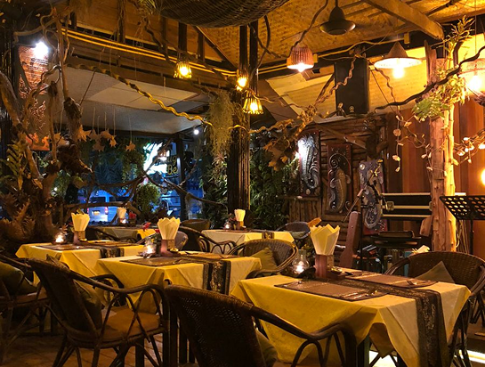

<div align="center">



# Carro Edeg — Digital Menu

**A fast, elegant digital menu and table-reservation site for Carro Edeg Hotel & Restaurant, Hargeisa.**

Browse the full menu by category, explore the gallery, and book a table — guests get a branded confirmation email with their table number.


</div>

---

## Overview

Carro Edeg Digital Menu replaces the printed menu with a polished, mobile-first website. Guests can browse dishes and prices, see the restaurant, and reserve a table in under a minute. Every reservation triggers a styled HTML confirmation email sent through Gmail.

## Features

- **Interactive menu** — 11 categories (Breakfast, Cold & Hot Starters, Lunch and Dinner dishes, Pizza Corner, Fast Foods, Indian Dishes, Drinks, Mojito, Desserts) with animated card transitions when switching between them.
- **Table reservations** — form with client-side validation, a guest stepper (1–12), and past dates blocked in the date picker.
- **Confirmation emails** — a branded HTML email with the guest's name, date, time, party size, phone and an assigned table number (`T-###`), sent via Nodemailer + Gmail.
- **Signature specials** — a curated chef's selection section on the home page.
- **Photo gallery** — responsive mosaic grid with lazy-loaded images and a "View more photos" button that reveals six at a time.
- **Smooth motion** — GSAP and ScrollTrigger entrance animations, an auto-scrolling image marquee, and an animated custom error page. Animations are softened for users who prefer reduced motion.
- **Responsive by default** — designed for phones first, scaling up to wide desktop layouts.
- **Custom 404 / error page** — on-brand instead of the framework default.

## Tech Stack

| Area       | Technology                                                    |
| ---------- | ------------------------------------------------------------- |
| Framework  | [SvelteKit 2](https://svelte.dev/docs/kit) with Svelte 5 (runes) |
| Language   | TypeScript                                                    |
| Styling    | [Tailwind CSS 4](https://tailwindcss.com) via `@tailwindcss/vite` |
| Animation  | [GSAP](https://gsap.com) + ScrollTrigger                      |
| Icons      | [`@lucide/svelte`](https://lucide.dev)                        |
| Email      | [Nodemailer](https://nodemailer.com) (Gmail transport)        |
| Tooling    | Vite 8, ESLint, Prettier (Svelte + Tailwind plugins), svelte-check |
| Hosting    | Vercel (`@sveltejs/adapter-vercel`)                           |
| Fonts      | Lora, Inter, Roboto, Space Grotesk (Google Fonts)             |

## Pages and Routes

| Route                    | Description                                                               |
| ------------------------ | ------------------------------------------------------------------------- |
| `/`                      | Home — hero, image marquee, signature specials, gallery, booking form     |
| `/restaurant`            | Full menu with category filter, gallery, booking form                     |
| `POST /api/reservations` | Validates a reservation and emails the guest a confirmation               |

The app is client-rendered (`ssr = false` in `src/routes/+layout.server.ts`).

## Project Structure

```text
digital-menu/
├── src/
│   ├── lib/
│   │   └── components/
│   │       ├── header.svelte         # Top bar, logo, "Book table" CTA
│   │       ├── footer.svelte         # Contact details and quick links
│   │       ├── hero.svelte           # Home hero
│   │       ├── resturentHero.svelte  # Menu page hero with breadcrumb
│   │       ├── slides.svelte         # Auto-scrolling image marquee
│   │       ├── signature.svelte      # Signature specials
│   │       ├── menu.svelte           # Menu data + category filter + cards
│   │       ├── gallery.svelte        # Paginated photo gallery
│   │       └── booktable.svelte      # Reservation form
│   └── routes/
│       ├── +layout.svelte            # Header + footer shell
│       ├── +layout.server.ts         # Disables SSR
│       ├── +page.svelte              # Home
│       ├── +error.svelte             # Custom error page
│       ├── layout.css                # Tailwind theme and design tokens
│       ├── restaurant/+page.svelte   # Menu page
│       └── api/reservations/+server.ts  # Reservation endpoint + email template
├── static/                           # Logo, banner, menu and gallery images
├── svelte.config.js
├── vite.config.ts
└── package.json
```

## Getting Started

### Prerequisites

- A current **Node.js LTS** release and **npm** (the project enforces `engine-strict` via `.npmrc`)
- A **Gmail account** with an [App Password](https://support.google.com/accounts/answer/185833) for sending confirmation emails (requires 2-Step Verification)

### Installation

```bash
git clone https://github.com/Amiid5/digital-menu.git
cd digital-menu
npm install
```

### Configure environment variables

Create a `.env` file in the project root:

```bash
GMAIL_USER=your-address@gmail.com
GMAIL_PASS=your-16-character-app-password
```

| Variable     | Required | Description                                                       |
| ------------ | -------- | ----------------------------------------------------------------- |
| `GMAIL_USER` | Yes      | Gmail address used as the sender of confirmation emails           |
| `GMAIL_PASS` | Yes      | Gmail **App Password** (not your normal account password)         |

> These are read with SvelteKit's `$env/static/private`, so they must be set **before** `npm run dev` or `npm run build`. Never commit `.env` — it is already in `.gitignore`.

### Run locally

```bash
npm run dev
```

Open the URL printed in the terminal (Vite defaults to `http://localhost:5173`). Use `npm run dev -- --open` to open it in your browser automatically.

### Build for production

```bash
npm run build
npm run preview
```

## Available Scripts

| Script                | What it does                                  |
| --------------------- | --------------------------------------------- |
| `npm run dev`         | Start the Vite dev server                     |
| `npm run build`       | Create a production build                     |
| `npm run preview`     | Preview the production build locally          |
| `npm run check`       | Type-check with `svelte-check`                |
| `npm run check:watch` | Type-check in watch mode                      |
| `npm run lint`        | Prettier check + ESLint                       |
| `npm run format`      | Format the codebase with Prettier             |

## Reservation API

`POST /api/reservations` — accepts JSON and sends the confirmation email.

**Request body**

```json
{
  "name": "Amina Yusuf",
  "email": "amina@example.com",
  "phone": "+252 63 000 0000",
  "date": "2026-11-14",
  "time": "19:30",
  "guests": 4
}
```

**Responses**

| Status | Body                                                          | When                                  |
| ------ | ------------------------------------------------------------- | ------------------------------------- |
| `200`  | `{ "success": true, "tableNumber": "T-482" }`                 | Email sent                            |
| `400`  | `{ "message": "Missing required fields." }`                   | Any field is missing                  |
| `500`  | `{ "message": "Failed to send confirmation. Please try again." }` | Email could not be sent           |

## Customization

- **Menu items and prices** — edit the `menuData` array and `categories` list in `src/lib/components/menu.svelte`.
- **Images** — menu and gallery pictures live in `static/slides/` and `static/showCase/`; the logo is `static/Carro-Edeg-Hotel-logo.webp`.
- **Contact details and quick links** — `src/lib/components/footer.svelte`.
- **Brand colors and fonts** — design tokens and Tailwind theme in `src/routes/layout.css`; font imports in `src/app.html`.
- **Confirmation email design and wording** — the `buildEmail` function in `src/routes/api/reservations/+server.ts`.

## Deployment

The project uses `@sveltejs/adapter-vercel`, so it deploys to [Vercel](https://vercel.com) with no extra configuration:

1. Import the repository in Vercel.
2. Add `GMAIL_USER` and `GMAIL_PASS` under **Settings → Environment Variables**.
3. Deploy.

## Known Limitations and Roadmap

- Reservations are **not stored** anywhere — the endpoint only emails the guest, and the restaurant is not notified. Table numbers are random, so two bookings can receive the same number.
- No availability or capacity checks; the server only verifies that required fields are present.
- Menu data is hard-coded in a component rather than loaded from a CMS or database.
- Ideas for next steps: save reservations to a database, notify the restaurant by email or WhatsApp, add an admin view, add multi-language support, and render pages on the server for better SEO.

## Author

Built by **Amin Ahmed Mohamed**

- Portfolio: [amiid.vercel.app](https://amiid.vercel.app)
- GitHub: [@Amiid5](https://github.com/Amiid5)

---

<div align="center">
<sub>© Carro Edeg. All rights reserved.</sub>
</div>
